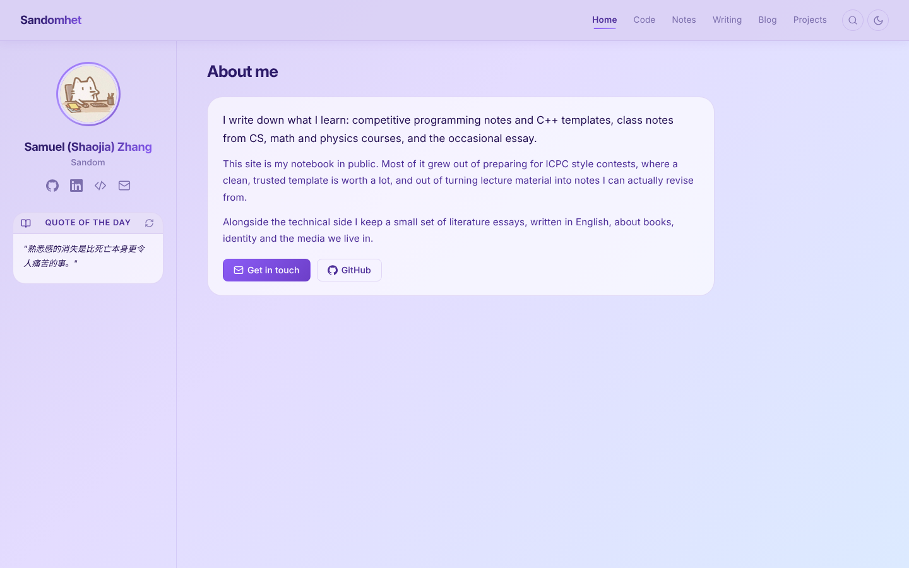
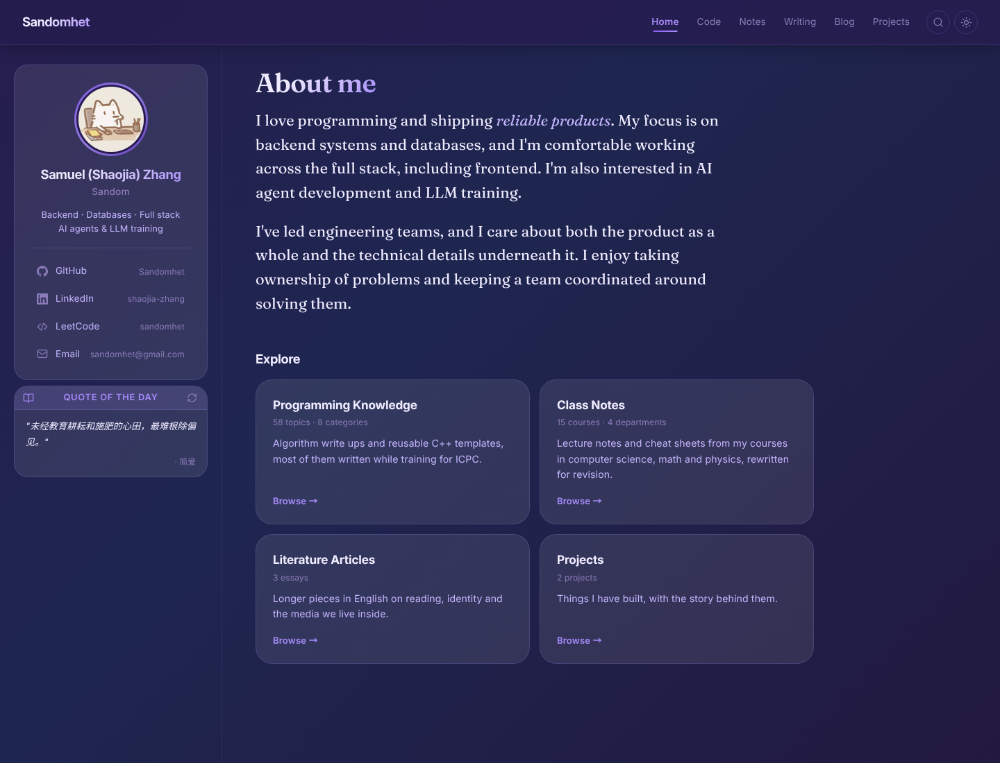
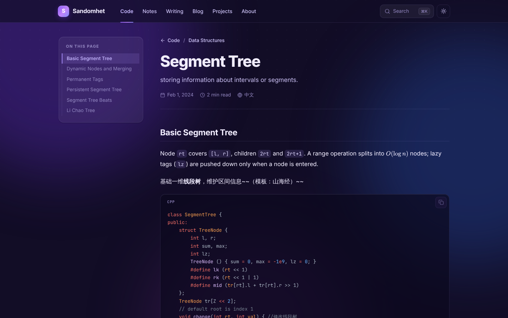

# Sandomhet's Portfolio

Samuel Zhang's personal site: programming knowledge and C++ templates, class notes, literature essays, a personal blog, projects and an About me section.

Built with [Astro](https://astro.build) as a fully static site. Markdown is rendered at build time with KaTeX for math and Prism for code, and [Pagefind](https://pagefind.app) provides full text search. The look (Misty Grape light theme, Twilight dark theme, frosted cards, profile sidebar) is kept from the original React version; its stylesheets live in `src/styles/legacy.css` and `src/styles/code.css`.





## Sections

| Route | What lives there | Source folder |
| --- | --- | --- |
| `/code` | Algorithms, data structures and code templates | `src/content/code/<Category>/` |
| `/notes` | Class notes, grouped by department | `src/content/notes/<Department>/` |
| `/writing` | Literature articles and essays | `src/content/writing/` |
| `/blog` | Personal blog posts | `src/content/blog/` |
| `/projects` | Project showcase with illustrated cards | `src/content/projects/` |
| `/` | About me, with profile, social links and quote of the day in the sidebar | `src/data/site.ts` |

The folder a file sits in becomes its category, and the file name becomes its URL (`src/content/code/Graph/mst.md` → `/code/mst`). File names must be unique within a section.

## Adding content

Create a Markdown file in the right folder with this front matter:

```md
---
title: "Segment Tree"
description: "One line shown in lists and search."
time: "Sat Oct 17, 2026"   # any date JavaScript can parse
lang: "zh"                 # "zh" (default) or "en"
draft: false               # true keeps the file out of the site
---
```

Projects take a few extra fields:

```md
summary: "One or two sentences for the card."
tech: ["C++", "Astro"]
repo: "https://github.com/..."   # optional
demo: "https://..."              # optional
cover: "/images/my-cover.png"    # optional, otherwise an illustration is generated
featured: true                   # listed first on the Projects page
```

A blog post template is in `src/content/blog/_template.md`. Images go in `public/images/` and are referenced as `/images/name.png`.

Personal details (name, intro, About me text, social links, section names) are all in `src/data/site.ts`.

The quote widget reads `src/data/quotes.json`. To regenerate it from `src/data/Quotes.xlsx`, run `npm run quotes`.

## Editing online

`/edit` is a side by side editor: Markdown on the left, a live preview on the right that runs the same Markdown pipeline as the build (GFM, KaTeX, Prism, the TOC heading filter), so it looks like the published page.

1. Create a [fine-grained GitHub token](https://github.com/settings/personal-access-tokens/new) with access to only this repository and **Contents: Read and write**.
2. Open `/edit` on the site and paste it. It is stored in that browser's local storage and sent only to the GitHub API.
3. Every post now shows a pencil button next to the breadcrumb (only in a browser that has signed in). Or open `/edit?file=src/content/blog/new-post.md` to start a new file.

Save (or Ctrl/Cmd S) commits the file to `main` through the GitHub API, and Vercel rebuilds the site, so changes go live after about a minute. Unsaved text is kept as a draft in the browser until it is saved or discarded. The repository and branch are set in `editor` in `src/data/site.ts`.

## Development

```sh
npm install
npm run dev       # http://localhost:4321
npm run build     # static site in dist/, plus the search index
npm run preview   # serve the built site (search works here)
npm run check     # type check
```

Search only works on a built site because the index is generated after `astro build`.

## Deployment

The site is deployed on Vercel. `vercel.json` sets the framework to Astro, the output folder to `dist`, clean URLs, and redirects from the old routes (`/blogs/*` → `/code/*`, `/articles/*` → `/writing/*`, and the documents that used to live under `/projects`, which are now in the blog).
