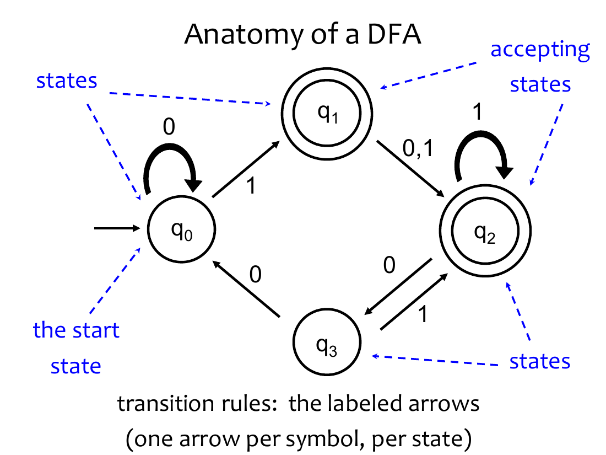
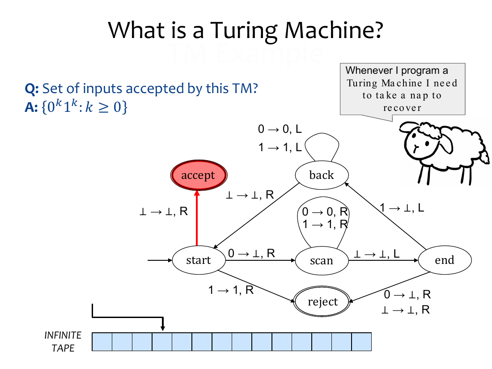
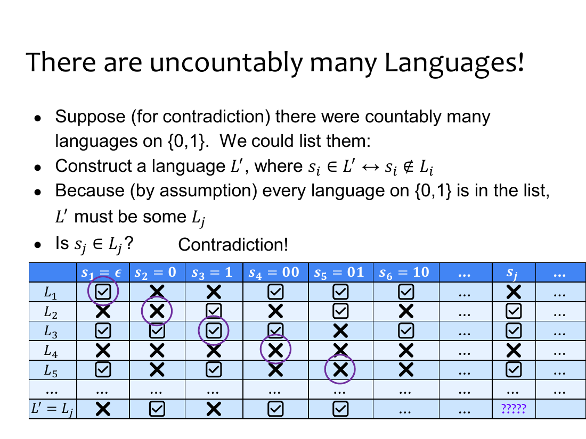

# EECS 376 Notes: Algorithms and Computability

**Notation.** $\perp$ is the blank tape symbol. $\langle M\rangle$ is the string encoding of a Turing machine $M$; every string is treated as the encoding of some TM (a string that is not a valid encoding stands for a fixed machine that rejects every input). $D_B$ is a black box that decides language $B$. $M_A$ is a machine being constructed to decide $A$. $n$ is the input size unless stated otherwise.

---

## Contents

**Part I. Algorithms**

1. [Foundations of algorithm analysis](#1-foundations-of-algorithm-analysis)
2. [The potential method](#2-the-potential-method)
3. [Divide and conquer](#3-divide-and-conquer)
4. [Dynamic programming](#4-dynamic-programming)
5. [Greedy algorithms](#5-greedy-algorithms)
6. [Algorithms at a glance](#6-algorithms-at-a-glance)

**Part II. Computability**

7. [Overview: problems, machines, and what they can decide](#7-overview-problems-machines-and-what-they-can-decide)
8. [Strings and languages](#8-strings-and-languages)
9. [Deterministic finite automata](#9-deterministic-finite-automata)
10. [Turing machines](#10-turing-machines)
11. [Countability and diagonalization](#11-countability-and-diagonalization)
12. [Undecidability and Turing reductions](#12-undecidability-and-turing-reductions)
13. [Recognizability](#13-recognizability)
14. [Languages at a glance](#14-languages-at-a-glance)

---

# Part I. Algorithms

## 1. Foundations of algorithm analysis

### 1.1 Running times

* **Worst case** $T(n)$: the maximum number of steps over all inputs of size $n$. This is the default.
* **Best case**: the minimum number of steps over all inputs of size $n$.
* **Average case**: the expected number of steps for an input drawn from an assumed distribution.

**Input size** is the number of symbols (usually bits) needed to write the input; an integer $N$ takes $\Theta(\log N)$ bits. An algorithm is **efficient** if it runs in polynomial time in the input size.

### 1.2 Asymptotic notation

| Notation | Meaning |
|---|---|
| $f(n) = O(g(n))$ | there are positive constants $c, n_0$ with $f(n) \le c\,g(n)$ for all $n \ge n_0$ |
| $f(n) = \Omega(g(n))$ | there are positive constants $c, n_0$ with $f(n) \ge c\,g(n)$ for all $n \ge n_0$ |
| $f(n) = \Theta(g(n))$ | both of the above (the two constants may differ) |

$O$ is only an upper bound and $\Omega$ only a lower bound.

### 1.3 Giving an algorithm

1. A brief English description of the structure and main steps, naming the design paradigm.
2. Precise pseudocode.
3. A **correctness argument** and a **runtime analysis** (worst case, in terms of the input size; for divide and conquer, a recurrence and its solution).

### 1.4 Proof: induction

> **Template: proof by induction**
>
> 1. **Claim:** state precisely what is proved, for which objects, and what quantity the induction is on.
> 2. **Base case:** prove the claim for the smallest size.
> 3. **Inductive hypothesis:** assume the claim for size $n$ (strong induction: for every size up to $n$).
> 4. **Inductive step:** take an **arbitrary** object of size $n+1$ and prove the claim using the hypothesis.
> 5. **Conclusion:** by induction, the claim holds for every size.
>
> Use strong induction for recursive algorithms, whose recursive calls are on various smaller inputs.

#### 1.4.1 Euclid's algorithm is correct

**Claim.** For all integers $x > y \ge 0$, Euclid$(x, y)$ (§2.1.1) returns $\gcd(x, y)$. Strong induction on $y$.

**Proof.**

* **Base case** $y = 0$: Euclid returns $x$, and $\gcd(x, 0) = x$ since $x > 0$.
* **Inductive hypothesis:** for some $y \ge 1$, Euclid$(x', y') = \gcd(x', y')$ for all $x' > y' \ge 0$ with $y' < y$.
* **Inductive step:** take arbitrary $x > y \ge 1$. Euclid returns Euclid$(y, x \bmod y)$. Since $y > x \bmod y \ge 0$, this is a valid input whose second argument is smaller than $y$, so by the hypothesis it returns $\gcd(y, x \bmod y) = \gcd(x \bmod y, y) = \gcd(x, y)$ by the key identity.
* **Conclusion:** by strong induction, Euclid is correct on every valid input. ∎

### 1.5 Graph terminology

A **graph** $G = (V, E)$ has vertices $V$ and edges $E$, with $n = |V|$ and $m = |E|$.

* **Simple**: every edge joins two different vertices and no two edges join the same pair. **Directed**: each edge is an ordered pair $(u, v)$. **Subgraph**: $V' \subseteq V$, $E' \subseteq E$.
* **Degree** $\deg(v)$ in an undirected graph: edges at $v$, a loop counting twice. **Complete graph**: a simple graph with one edge between each pair of distinct vertices.
* **Path**: consecutive vertices joined by edges; **simple path**: no repeated vertex. **Cycle**: $v_1, \dots, v_n$ with edges $(v_1, v_2), \dots, (v_n, v_1)$. **Hamiltonian** path or cycle: visits every vertex exactly once.
* **Connected**: every pair of vertices is joined by a path. **Acyclic**: no cycle. **Tree**: connected and acyclic. **Spanning tree**: a subgraph that is a tree containing every vertex.
* **Bipartite**: $V = V_1 \sqcup V_2$ with every edge between $V_1$ and $V_2$.
* **Vertex cover** $C$: every edge has an endpoint in $C$. **Dominating set** $S$: every vertex is in $S$ or adjacent to $S$. **Independent set** $S$: no edge joins two distinct vertices of $S$.

---

## 2. The potential method

A **potential** $S_i$ is a quantity that is bounded at the start, bounded below, and decreases by a guaranteed amount every unit of time, which bounds the number of time units.

### 2.1 Proof: potential method

> **Template: potential method**
>
> 1. Define the **unit of time** (one iteration, one recursive call, one turn).
> 2. Define the **potential** $S_i$ at time $i$.
> 3. Give an **upper bound on $S_0$**.
> 4. Give a **lower bound on $S_i$** (often 0).
> 5. Show $S_i$ decreases by at least a fixed amount (or factor) per unit time.
> 6. Conclude an upper bound on the number of time units.
>
> * **Additive:** if $S_0 \le U$, $S_i \ge 0$, and $S_{i+1} \le S_i - \delta$ for a fixed $\delta > 0$, there are at most $U/\delta$ steps.
> * **Multiplicative:** if $S_{i+1} \le c\,S_i$ with constant $0 < c < 1$ and $S_i \ge 1$, then $1 \le c^k S_0$, so $k \le \log_{1/c} S_0$.

#### 2.1.1 Euclid's algorithm makes $O(n)$ recursive calls

**gcd**: given $n$ digit integers $x > y \ge 0$, not both 0, find the largest integer dividing both. Key identity: $\gcd(x, y) = \gcd(x \bmod y, y)$ for $y \ge 1$.

```
Euclid(x, y):          // x > y >= 0
  if y = 0: return x
  return Euclid(y, x mod y)
```

**Claim.** Euclid makes $O(n)$ recursive calls, so it runs in $O(n)\cdot\text{poly}(n)$ time. (Correctness: §1.4.1.)

**Proof.** Write $(x_i, y_i)$ for the arguments of the $i$th call, so $x_{i+1} = y_i$ and $y_{i+1} = x_i \bmod y_i$.

1. Unit of time: one recursive call.
2. $S_i = x_i + y_i$.
3. $S_0 = x + y < 2\cdot 10^n$.
4. $S_i \ge 1$, since $x_i \ge 1$.
5. $S_{i+1} < \tfrac23 S_i$ whenever call $i$ recurses ($y_i \ge 1$):
   * if $y_i > \tfrac12 x_i$: $x_i \bmod y_i = x_i - y_i$, so $S_{i+1} = y_i + (x_i - y_i) = x_i = \tfrac23(x_i + \tfrac12 x_i) < \tfrac23(x_i + y_i)$;
   * if $y_i \le \tfrac12 x_i$: $S_{i+1} = y_i + (x_i \bmod y_i) < 2y_i = \tfrac23(2y_i + y_i) \le \tfrac23(x_i + y_i)$.
6. After $k$ calls, $1 \le S_k < (2/3)^k S_0$, so $k < \log_{3/2} S_0 < \log_{3/2}(2\cdot 10^n) = O(n)$. ∎

---

## 3. Divide and conquer

### 3.1 The Master Theorem

Let $k \ge 1$, $b > 1$, $d \ge 0$, and $w \ge 0$ be constants, and

$$T(n) = k\,T(n/b) + O(n^d\log^w n).$$

$$T(n) = \begin{cases} O(n^d\log^w n) & \text{if } k < b^d\\[2pt] O(n^d\log^{w+1} n) & \text{if } k = b^d\\[2pt] O(n^{\log_b k}) & \text{if } k > b^d \end{cases}$$

| Recurrence | $k, b, d, w$ | Case | Solution |
|---|---|---|---|
| $2T(n/2) + O(n)$ (mergesort, closest pair) | 2, 2, 1, 0 | $k = b^d$ | $O(n\log n)$ |
| $4T(n/2) + O(n)$ (naive multiplication) | 4, 2, 1, 0 | $k > b^d$ | $O(n^2)$ |
| $3T(n/2) + O(n)$ (Karatsuba) | 3, 2, 1, 0 | $k > b^d$ | $O(n^{\log_2 3}) \approx O(n^{1.585})$ |

### 3.2 Integer multiplication

Multiply two $n$ digit integers; single digit operations and shifts cost $O(1)$.

Split $x = x_L\cdot 10^{n/2} + x_R$ and $y = y_L\cdot 10^{n/2} + y_R$:
$$xy = x_Ly_L\cdot 10^n + (x_Ly_R + x_Ry_L)\cdot 10^{n/2} + x_Ry_R.$$
This uses four recursive products.

**Karatsuba**: with $M_1 = (x_L + x_R)(y_L + y_R)$, $M_2 = x_Ly_L$, $M_3 = x_Ry_R$,
$$xy = M_2\cdot 10^n + (M_1 - M_2 - M_3)\cdot 10^{n/2} + M_3,$$
which uses three recursive products. Running times: §3.1 table.

### 3.3 Closest pair of points

Given $n$ points in $\mathbb R^2$, find a closest pair. Checking all pairs takes $O(n^2)$; divide and conquer takes $O(n\log n)$.

```
// X = points sorted by x; Y = points sorted by y
ClosestPair(X, Y):
  1. Divide points into left and right halves; create X_left, X_right, Y_left, Y_right
  2. d_left  = ClosestPair(X_left, Y_left)
  3. d_right = ClosestPair(X_right, Y_right)
  4. d = min(d_left, d_right)
  5. Y_d = points within distance d of the middle line, sorted by y
  6. For each p in Y_d: compare p to the next 7 points in Y_d
  7. d_next7 = minimum distance found in step 6
  8. return min(d, d_next7)
```

The recursion is $T(n) = 2T(n/2) + O(n)$, so the total is $O(n\log n)$. Step 6 suffices because a $d\times 2d$ rectangle straddling the middle line holds **at most 8 points**.

**Proof (at most 8 points).** Split the rectangle into eight $d/2 \times d/2$ squares. Each square lies on one side of the middle line, so any two points in it are at distance at least $d = \min(d_{left}, d_{right})$. A square's diameter is $d/\sqrt 2 < d$, so it holds at most one point.

If a point $q$ above $p$ in $Y_d$ is within distance $d$ of $p$, both lie in the $d \times 2d$ rectangle whose bottom edge is at $p$'s height. That rectangle holds at most 8 points, so $q$ is among the next 7 points after $p$. ∎

---

## 4. Dynamic programming

* **Top down recursion**: exponentially many calls in general.
* **Top down with memoization**: store and reuse computed results.
* **Bottom up table filling**: fill from the base cases up; running time = (table size)·(time per entry). This is the standard method.

### 4.1 Template: DP recipe

> **Template: DP recipe**
>
> 1. Define the **value version** of what you compute.
> 2. Derive a **recurrence** ("use it or lose it" on the last element).
> 3. **Table size**: number of dimensions and the range of each.
> 4. **Base cases.**
> 5. **Fill order**: which cells each cell depends on.
> 6. Which cell holds the **final answer**.
> 7. **Running time**: (table size)·(time per entry).
> 8. **Reconstruction**: follow the choices from the answer back to a base case.

### 4.2 Longest increasing subsequence

END-LIS($A[1..i]$) is the length of a longest increasing subsequence of $A[1..i]$ **ending at $A[i]$**:

$$\text{END-LIS}(A[1..i]) = 1 + \max\{\text{END-LIS}(A[1..j]) : j < i,\ A[j] < A[i]\},$$

or 1 if no such $j$ exists. The answer is $\max_i \text{END-LIS}(A[1..i])$.

```
LIS(A[1..n]):
  table := array indexed 1 to n
  for i = 1 to n:
    if no j < i has A[j] < A[i]: table(i) = 1
    else: table(i) = 1 + max{table(j) : j < i, A[j] < A[i]}
  return max_i table(i)
```

$O(n^2)$: $n$ cells, each scanning up to $n$ cells.

### 4.3 Longest common subsequence

$$\text{LCS}(S_1[1..N], S_2[1..M]) = \begin{cases} \text{LCS}(S_1[1..N{-}1], S_2[1..M{-}1]) + 1 & \text{if } S_1[N] = S_2[M]\\[2pt] \max\{\text{LCS}(S_1[1..N{-}1], S_2[1..M]),\ \text{LCS}(S_1[1..N], S_2[1..M{-}1])\} & \text{otherwise}\end{cases}$$

LCS $= 0$ when either string is $\varepsilon$.

```
LCS(S1[1..N], S2[1..M]):
  table := 2D array indexed 0..N and 0..M
  for i = 0 to N: table(i, 0) = 0
  for j = 0 to M: table(0, j) = 0
  for i = 1 to N:
    for j = 1 to M:
      if S1[i] = S2[j]: table(i, j) = 1 + table(i-1, j-1)
      else: table(i, j) = max{table(i-1, j), table(i, j-1)}
  return table(N, M)
```

$O(NM)$. Reconstruct by walking back from $(N, M)$, collecting a symbol at each diagonal step.

### 4.4 0/1 knapsack

Items $t_i = (v_i, w_i)$ with integer weights and capacity $C$; maximize total value with total weight at most $C$.

$$K(t_1..t_i, c) = \max\begin{cases}K(t_1..t_{i-1}, c - w_i) + v_i & \text{if } w_i \le c \quad\text{(use it)}\\[2pt] K(t_1..t_{i-1}, c) & \text{(lose it)}\end{cases},\qquad K(\emptyset, c) = 0.$$

```
Knapsack({t_1, ..., t_n}, C):
  table := 2D array indexed 0..n and 0..C
  for c = 0 to C: table(0, c) = 0
  for i = 1 to n:
    for c = 0 to C:
      if w_i <= c: table(i, c) = max(v_i + table(i-1, c - w_i), table(i-1, c))
      else:        table(i, c) = table(i-1, c)
  return table(n, C)
```

$O(nC)$, not polynomial in the input size (about $n\log C$).

### 4.5 Shortest paths

Graphs are weighted and directed; weights may be negative but there is **no negative weight cycle**.

* $\text{dist}(s, t)$: the minimum total weight of an $s$ to $t$ path ($\infty$ if none).
* **SSSP**: shortest paths from a source $s$ to every vertex.
* **APSP**: shortest paths between every pair of vertices.
* **Principle of optimality**: if a shortest $s \to t$ path passes through $v$, its $s \to v$ and $v \to t$ parts are shortest paths.
* With no negative cycles, some shortest path has at most $n - 1$ edges.

**Bellman-Ford (SSSP).** $\text{dist}^{(i)}(s, v)$ is the length of a shortest $s \to v$ path using at most $i$ edges.

$$\text{dist}^{(i)}(s, v) = \min\Big\{\text{dist}^{(i-1)}(s, v),\ \min_{(u,v)\in E}\big(\text{dist}^{(i-1)}(s, u) + w(u, v)\big)\Big\},$$

with $\text{dist}^{(0)}(s, s) = 0$ and $\text{dist}^{(0)}(s, v) = \infty$ otherwise; the answer is $\text{dist}^{(n-1)}(s, v)$.

```
SSSP(G, s):                    // vertices v_0, ..., v_{n-1}, s = v_0
  table := 2D array indexed 0..n-1 (vertex) and 0..n-1 (edges i)
  table(0, 0) = 0
  for v = 1 to n-1: table(v, 0) = ∞
  for i = 1 to n-1:
    for v = 0 to n-1:
      table(v, i) = min{table(v, i-1), min over (u,v) ∈ E of table(u, i-1) + w(u, v)}
  return table(v, n-1) as dist(s, v) for each v
```

$\Theta(nm)$. A negative cycle is reachable from $s$ iff $\text{dist}^{(n)}(s, v) < \text{dist}^{(n-1)}(s, v)$ for some $v$ (run one extra round).

**APSP.**

* Bellman-Ford from every vertex: $\Theta(mn^2)$.
* **Path doubling**: $\text{dist}^{(2^i)}(u, v) = \min_{x\in V}\{\text{dist}^{(2^{i-1})}(u, x) + \text{dist}^{(2^{i-1})}(x, v)\}$, with $\text{dist}^{(1)}(u,v)$ equal to 0 if $u = v$, $w(u, v)$ if $(u, v) \in E$, $\infty$ otherwise; $\Theta(n^3\log n)$.
* **Floyd-Warshall**: order vertices $v_1, \dots, v_n$; $\text{dist}^{(i)}(s, t)$ allows only $v_1, \dots, v_i$ as intermediate vertices:
  $$\text{dist}^{(i)}(s, t) = \min\{\text{dist}^{(i-1)}(s, t),\ \text{dist}^{(i-1)}(s, v_i) + \text{dist}^{(i-1)}(v_i, t)\},$$
  with base case 0 if $s = t$, $w(s, t)$ if $(s, t)\in E$, $\infty$ otherwise.

```
APSP(G):
  table := 3D array (1..n, 1..n, 0..n)
  for s = 1 to n, for t = 1 to n:
    table(s, t, 0) = 0 if s = t; w(s, t) if (s, t) ∈ E; ∞ otherwise
  for i = 1 to n:
    for s = 1 to n:
      for t = 1 to n:
        table(s, t, i) = min{table(s, t, i-1), table(s, i, i-1) + table(i, t, i-1)}
  return table(s, t, n) for all s, t
```

$\Theta(n^3)$.

---

## 5. Greedy algorithms

A **greedy algorithm** repeatedly makes the locally best choice, never undoing it. A choice is **safe** if it lies in some optimal solution together with all earlier choices.

| Paradigm | Speed | Applicability |
|---|---|---|
| Greedy | fast | fails for most problems |
| Divide and conquer | often between greedy and DP | when solutions to disjoint subproblems combine |
| Dynamic programming | generally slower, still usually efficient | many problems |

### 5.1 Proof: exchange argument

> **Template: exchange argument**
>
> Transform any optimal solution into the greedy one, one exchange at a time, keeping it **valid** and its value **no worse**.
>
> 1. Let ALG $= a_1, a_2, \dots, a_k$ in greedy order and OPT any optimal solution; if OPT = ALG, done.
> 2. Let $a_{diff}$ be the first element of ALG not in OPT, so OPT contains $a_1, \dots, a_{diff-1}$.
> 3. Pick an element $o$ of OPT, not among $a_1, \dots, a_{diff-1}$, and form $OPT' = OPT - o + a_{diff}$.
> 4. Show OPT' is **valid**.
> 5. Show OPT' is **optimal** (value no worse than OPT).
> 6. OPT' is optimal and contains $a_1, \dots, a_{diff}$. By induction, some optimal solution $S$ contains all of ALG. Show $S$ has nothing outside ALG, so $S = $ ALG and ALG is optimal.

#### 5.1.1 Unweighted task selection

Choose a largest set of non intersecting intervals. **Earliest Ending Time (EET)**: take an interval that ends first, discard the intervals overlapping it, repeat.

```
task_selection(s_1..s_n, f_1..f_n):   // sorted by finish time
  S := ∅
  for j = 1 to n:
    if task j is compatible with S: S := S ∪ {j}
  return S
```

$O(n)$ after sorting.

**Claim.** EET is optimal.

**Proof.**

1. Let ALG $= I_1, \dots, I_k$ in the order EET picks them (increasing end time), and OPT any optimal solution.
2. Let $I_{diff}$ be the first interval of ALG not in OPT, so OPT contains $I_1, \dots, I_{diff-1}$.
3. Let $J_{diff}$ be the earliest ending interval of OPT not in ALG. It exists: otherwise OPT $\subseteq$ ALG $- I_{diff}$, so $|OPT| < |ALG|$. Set $OPT' = OPT - J_{diff} + I_{diff}$.
   * **Key fact:** $\text{end}(I_{diff}) \le \text{end}(J_{diff})$. $J_{diff}$ is compatible with $I_1, \dots, I_{diff-1}$ (all in OPT). If EET examined $J_{diff}$ before $I_{diff}$, its set $S$ at that time was a subset of $\{I_1, \dots, I_{diff-1}\}$, so EET would have added $J_{diff}$, contradicting $J_{diff} \notin$ ALG.
4. **Valid.** Intervals of OPT' other than $I_{diff}$ are in OPT and pairwise compatible. For $I_{diff}$:
   * intervals of OPT' that are in ALG are compatible with $I_{diff}$, as in ALG;
   * any other $J' \in OPT'$ is in OPT, not in ALG, and $J' \ne J_{diff}$, so $\text{end}(J') \ge \text{end}(J_{diff})$ and $J'$ does not overlap $J_{diff}$; hence $\text{start}(J') \ge \text{end}(J_{diff}) \ge \text{end}(I_{diff})$.
5. **Optimal.** $|OPT'| = |OPT| - 1 + 1 = |OPT|$.
6. By induction some optimal $S$ contains all of ALG. If $S$ had an interval $J \notin$ ALG, $J$ would be compatible with all of ALG, so EET would have added $J$ when it examined it. Hence $S =$ ALG. ∎

#### 5.1.2 Minimum spanning trees

A **minimum spanning tree** (MST) is a spanning tree of minimum total weight in an undirected connected graph with positive edge weights. A minimum weight connected spanning subgraph is always a tree.

**Kruskal**: add a minimum weight edge that creates no cycle.

```
Kruskal(G):
  T ← V                  // vertices only; invariant: T has no cycles
  for each edge e in increasing order of weight:
    if T + e is acyclic: T ← T + e
  return T
```

$O(m\log m)$.

**Claim.** Kruskal is optimal.

**Proof.**

1. Let ALG $= e_1, e_2, \dots$ in the order Kruskal adds them, and OPT any MST.
2. Let $e_{diff}$ be the first edge of ALG not in OPT, so OPT contains $e_1, \dots, e_{diff-1}$.
3. Adding $e_{diff}$ to the tree OPT creates exactly one cycle $C$. Since ALG is acyclic, some edge $f$ of $C$ is not in ALG; so $f \ne e_{diff}$, $f \in OPT$, and $f \notin \{e_1, \dots, e_{diff-1}\}$. Set $OPT' = OPT + e_{diff} - f$.
4. **Valid.** Removing an edge of $C$ keeps the graph connected, and $C$ is the only cycle created by adding $e_{diff}$, so OPT' is a spanning tree.
5. **Optimal.** $w(e_{diff}) \le w(f)$: otherwise Kruskal examined $f$ before $e_{diff}$, when $T \subseteq \{e_1, \dots, e_{diff-1}\}$. Then $T + f \subseteq OPT$ is acyclic, so Kruskal would have added $f$, contradicting $f \notin$ ALG. Hence $w(OPT') \le w(OPT)$.
6. By induction some MST $S$ contains all of ALG. ALG is a spanning tree, so both have $n - 1$ edges and $S =$ ALG. ∎

---

## 6. Algorithms at a glance

| Algorithm | Problem | Technique | Running time |
|---|---|---|---|
| Euclid | gcd of $n$ digit integers | potential method | $O(n)$ calls, each $\text{poly}(n)$ |
| Mergesort | sorting | divide and conquer | $O(n\log n)$ |
| Karatsuba | multiply $n$ digit integers | divide and conquer | $O(n^{\log_2 3}) \approx O(n^{1.585})$ |
| Closest pair | closest pair in $\mathbb R^2$ | divide and conquer | $O(n\log n)$ |
| Weighted task selection | max value disjoint intervals | DP | $O(n\log n)$ |
| LIS | longest increasing subsequence | DP | $O(n^2)$ |
| LCS | longest common subsequence | DP | $O(NM)$ |
| Knapsack | 0/1 knapsack | DP | $O(nC)$ |
| Bellman-Ford | SSSP, negative edges allowed | DP | $\Theta(nm)$ |
| Bellman-Ford from every vertex | APSP | DP | $\Theta(mn^2)$ |
| Path doubling | APSP | DP | $\Theta(n^3\log n)$ |
| Floyd-Warshall | APSP | DP | $\Theta(n^3)$ |
| Earliest ending time | unweighted task selection | greedy | $O(n)$ on sorted input |
| Kruskal | MST | greedy | $O(m\log m)$ |

---

# Part II. Computability

## 7. Overview: problems, machines, and what they can decide

A **decision problem** has Yes/No solutions, considered as **language** $L = \{x \in \Sigma^* : \text{the answer on } x \text{ is Yes}\}$.

**Machines.** A machine $M$ run on input $x$ either **accepts**, **rejects**, or (for Turing machines) **loops** forever. Its **language** is $L(M) = \{x : M \text{ accepts } x\}$.

| | $M$ **decides** $L$ | $M$ **recognizes** $L$ |
|---|---|---|
| on $x \in L$ | accepts | accepts |
| on $x \notin L$ | rejects | rejects or loops |
| equivalently | $L(M) = L$ and $M$ always halts | $L(M) = L$ |

* $L$ is **decidable** if some TM decides it, and **undecidable** otherwise.
* $L$ is **recognizable** if some TM recognizes it, and **unrecognizable** otherwise.
* $L$ is **co-recognizable** if $\overline L$ is recognizable.
* $L$ is **regular** if some DFA decides it (a DFA always halts).

**The landscape.**

$$\text{regular} \subsetneq \text{decidable} \subsetneq \text{recognizable}$$

* $\{x^ky^k\}$ is decidable but not regular; $L_{HALT}$ is recognizable but not decidable.
* $L$ is decidable **iff** it is both recognizable and co-recognizable (§13.2).
* Every TM recognizes exactly one language, so only countably many languages are recognizable or co-recognizable; almost all languages are neither.

**Closure properties.**

| Operation | Regular | Decidable | Recognizable |
|---|---|---|---|
| complement | closed (flip accepting states, §9.1) | closed (swap accept and reject) | **not** closed |
| intersection | | closed (run both deciders) | closed (run both recognizers in sequence) |
| union | | closed (run both deciders) | closed (alternate steps of the two recognizers) |

**Church-Turing thesis.** "Any natural notion of being 'algorithmically computable' is captured by Turing Machines."

**Proof techniques.**

| To show | Technique |
|---|---|
| $L$ is not regular | DFA impossibility (§9.3) |
| $L$ is decidable | pseudocode for a decider that always halts |
| $L$ is recognizable | pseudocode for a recognizer, which may loop off $L$ (§13.1) |
| a set is uncountable, or a first language is undecidable | diagonalization (§11.2) |
| $L$ is undecidable | Turing reduction from a known undecidable language (§12.3) |
| $L$ is unrecognizable | $L$ undecidable and $\overline L$ recognizable (§13.3) |

---

## 8. Strings and languages

* An **alphabet** $\Sigma$ is a nonempty finite set of symbols ($\{0,1\}$ by default).
* A **string** (word) is a finite sequence of zero or more symbols; $\varepsilon$ is the empty string.
* $a^k$ is $k$ a's, $a^*$ is zero or more, $a^+$ is one or more, $x|y$ is $x$ or $y$.
* $\Sigma^k$, $\Sigma^*$, $\Sigma^+$ are the strings of length $k$, all strings, and all nonempty strings.
* A **language** is any $L \subseteq \Sigma^*$; $\emptyset$ is the empty language.

---

## 9. Deterministic finite automata

### 9.1 Definition

A **DFA** is $M = (\Sigma, Q, q_0, F, \delta)$:

* a finite alphabet $\Sigma$;
* a nonempty finite set of states $Q$;
* a start state $q_0$;
* accepting states $F \subseteq Q$;
* a transition function $\delta: Q\times\Sigma \to Q$ (one arrow per symbol per state).

$M$ accepts $w$ if following $w$ from $q_0$ ends in $F$. Flipping accepting and non accepting states decides the complement.

**Sink** state: non accepting state with self loops on every symbol.

### 9.2 Examples



### 9.3 Proof: DFA impossibility

> **Template: DFA impossibility**
>
> A fixed string has one right answer, so the bad input must depend on the DFA. Find two strings with different answers on which the DFA must agree.
>
> 1. Suppose for contradiction that a DFA $M$ with $s$ states decides $L$.
> 2. Feed it a length $s$ prefix; among the $s + 1$ moments (after $0, 1, \dots, s$ symbols), two share a state, after prefixes $p_i$ and $p_j$ with $i < j$.
> 3. Append a common suffix $z$; $M$ ends in the same state on $p_iz$ and $p_jz$, so it gives the same answer on both.
> 4. Choose $z$ so exactly one of $p_iz$, $p_jz$ is in $L$; $M$ is wrong on one of them, a contradiction. So $L$ is not regular.

#### 9.3.1 $\{x^ky^k : k \ge 0\}$ is not regular

**Proof.**

1. Suppose a DFA $M$ with $s$ states decides $L = \{x^ky^k : k \ge 0\}$.
2. Run $M$ on $x^s$. The states after $\varepsilon, x, x^2, \dots, x^s$ are $s + 1$ visits to $s$ states, so by pigeonhole $\text{state}(x^i) = \text{state}(x^j)$ for some $0 \le i < j \le s$.
3. Append $z = y^i$: $M$ ends in the same state on $x^iy^i$ and $x^jy^i$.
4. $x^iy^i \in L$ but $x^jy^i \notin L$ since $j \ne i$, so $M$ is wrong on one of them. Contradiction, so $L$ is not regular. ∎

---

## 10. Turing machines

A **Turing machine** is a 7-tuple $M = (\Sigma, \Gamma, Q, q_{start}, q_{acc}, q_{rej}, \delta)$:

* $\Sigma$ is a finite input alphabet.
* $\Gamma$ is a finite tape alphabet, where $\Gamma \supseteq \Sigma$ with blank symbol $\perp \in \Gamma$, $\perp \notin \Sigma$.
* $Q$ is a finite set of states.
* $q_{start} \in Q$ is the initial state.
* $q_{acc} \in Q$ is the accepting state.
* $q_{rej} \in Q$ is the rejecting state.
* $\delta : Q \times \Gamma \to Q \times \Gamma \times \{L, R\}$ is the transition function.

A transition "$a \to b, R$" reads $a$, writes $b$, and moves right. The machine halts on entering $q_{acc}$ or $q_{rej}$.



---

## 11. Countability and diagonalization

### 11.1 Sizes of infinite sets

$f: A \to B$ is **injective** if distinct elements have distinct images; then $|A| \le |B|$, and $|A| = |B|$ when both $|A| \le |B|$ and $|B| \le |A|$.

A set is **countable** if it is not larger than $\mathbb N = \{0, 1, 2, \dots\}$, that is, its elements can be listed. Otherwise it is **uncountable**.

| Set | Countable? | Why |
|---|---|---|
| finite sets | yes | smaller than $\mathbb N$ |
| nonnegative evens | yes | $0, 2, 4, \dots$ |
| integers | yes | $0, 1, -1, 2, -2, \dots$ |
| rationals | yes | walk the $a/b$ table along diagonals |
| strings $\{0,1\}^*$ | yes | by length: $\varepsilon, 0, 1, 00, \dots$ |
| Turing machines | yes | each has a finite description |
| reals in $(0, 1)$ | **no** | diagonalization (§11.2.2) |
| languages over $\{0,1\}$ | **no** | diagonalization (§11.2.1) |

No single language is uncountable (every language is a subset of the countable $\Sigma^*$); it is the collection of languages that is uncountable.

### 11.2 Proof: diagonalization

> **Template: diagonalization**
>
> 1. Assume the set is countable and list it: $r_1, r_2, \dots$
> 2. Build $r^*$ differing from $r_i$ at position $i$ for every $i$.
> 3. Check that $r^*$ is in the set, so $r^* = r_j$ for some $j$.
> 4. Position $j$ of $r_j$ must equal and differ from itself: contradiction. So the set is uncountable.



#### 11.2.1 There are uncountably many languages over $\{0,1\}$

**Proof.**

1. List the strings as $s_1, s_2, \dots$ (they are countable) and assume the languages can be listed as $L_1, L_2, \dots$
2. Let $L' = \{s_i : s_i \notin L_i\}$, which differs from $L_i$ on $s_i$.
3. $L' \subseteq \{0,1\}^*$ is a language, so $L' = L_j$ for some $j$.
4. Then $s_j \in L_j \iff s_j \in L' \iff s_j \notin L_j$. Contradiction. ∎

#### 11.2.2 The reals in $(0,1)$ are uncountable

**Proof.**

1. Assume the reals in $(0,1)$ can be listed as $r_1, r_2, \dots$, and fix a decimal expansion $r_i = 0.d_{i1}d_{i2}d_{i3}\dots$ for each.
2. Let $r^* = 0.c_1c_2c_3\dots$ with $c_i = 5$ if $d_{ii} \ne 5$ and $c_i = 6$ if $d_{ii} = 5$, so $c_i \ne d_{ii}$.
3. $r^* \in [0.5, 0.7] \subset (0,1)$, so $r^* = r_j$ for some $j$. Since $r^*$ has no digit 0 or 9, its decimal expansion is unique, so it equals the listed expansion of $r_j$.
4. Then $c_j = d_{jj}$, but $c_j \ne d_{jj}$ by construction. Contradiction. ∎

#### 11.2.3 $L_{BARBER}$ is undecidable

$L_{BARBER} = \{\langle M\rangle : M \text{ does not accept } \langle M\rangle\}$.

**Proof.**

1. TMs are countable; list them as $M_1, M_2, \dots$ Form the table with rows $M_i$, columns $\langle M_j\rangle$, and entry 1 when $M_i$ accepts $\langle M_j\rangle$.
2. A decider for $L_{BARBER}$ accepts $\langle M_i\rangle$ iff entry $(i, i)$ is 0, so its row is the flipped diagonal, which differs from row $i$ at position $i$ for every $i$.
3. Suppose $D$ decides $L_{BARBER}$. $D$ is a TM, so $D = M_j$ for some $j$.
4. Then $M_j$ accepts $\langle M_j\rangle \iff \langle M_j\rangle \in L_{BARBER} \iff M_j$ does not accept $\langle M_j\rangle$. Contradiction. ∎

### 11.3 Consequence

There are countably many TMs, each deciding at most one language, but uncountably many languages, so **undecidable languages exist**, and most languages are undecidable. $L_{BARBER}$ (§11.2.3) is an explicit one.

---

## 12. Undecidability and Turing reductions

### 12.1 Undecidable languages

| Language | Members |
|---|---|
| $L_{BARBER}$ | $\langle M\rangle$: $M$ does not accept $\langle M\rangle$ |
| $L_{ACC}$ | $(\langle M\rangle, x)$: $M$ accepts $x$ |
| $L_{HALT}$ | $(\langle M\rangle, x)$: $M$ halts on $x$ |
| $L_{\varepsilon\text{-}HALT}$ | $\langle M\rangle$: $M$ halts on $\varepsilon$ |
| $L_{376}$ | $\langle M\rangle$: $376 \in L(M)$ |
| $L_\emptyset$ | $\langle M\rangle$: $L(M) = \emptyset$ |
| $L_{EQ}$ | $(\langle M_1\rangle, \langle M_2\rangle)$: $L(M_1) = L(M_2)$ (the autograder problem) |
| $L_{PRIMETESTERS}$ | $\langle M\rangle$: $L(M) = L_{PRIME} = \{n \ge 2 : n \text{ prime}\}$ |
| $L_{VEGGIE}$ | $\langle M\rangle$: MEAT $\notin L(M)$ |
| $L_{VEGAN}$ | $\langle M\rangle$: MEAT, MILK $\notin L(M)$ |

The **universal Turing machine** $U(\langle M\rangle, x)$ simulates $M$ on $x$, accepting, rejecting, or looping exactly as $M$ does.

### 12.2 Turing reductions

$A \le_T B$ means some TM decides $A$ using a black box $D_B$ that decides $B$. The machine may call $D_B$ on inputs of its choice, any number of times, and $D_B$ always halts correctly, even about computations that loop.

* If $A \le_T B$ and $B$ is decidable, then $A$ is decidable.
* **If $A \le_T B$ and $A$ is undecidable, then $B$ is undecidable.**

**Recurring techniques.**

* **Hard code the input.** $M_x(w)$: ignore $w$, run $M(x)$, and answer as it does. Then $L(M_x) = \Sigma^*$ if $M$ accepts $x$ and $L(M_x) = \emptyset$ otherwise, and $M_x$ halts on any given input iff $M$ halts on $x$. $M_A$ only builds $\langle M_x\rangle$ from $\langle M\rangle$ and $x$; it never runs it.
* **Run $M(x)$ only when it is known to halt**, for example after $D_{HALT}$ accepts.

### 12.3 Proof: Turing reduction

> **Template: Turing reduction**
>
> ```
> Goal: B undecidable, via A ≤_T B for a known undecidable A.
> Assume (for contradiction) B is decidable.
>
> Suppose we have:       D_B: y ∈ B ⇒ accepts;  y ∉ B ⇒ rejects  (always halts)
> We need to implement:  M_A: z ∈ A ⇒ accepts;  z ∉ A ⇒ rejects  (always halts)
>
> M_A(z):
>   1. Construct a machine M' from z if needed (do not run it).
>   2. Run D_B on an input built from z and ⟨M'⟩; answer as it does, or the opposite.
>
> Correctness:
>   z ∈ A ⇒ ... ⇒ D_B accepts (or rejects) ⇒ M_A accepts
>   z ∉ A ⇒ ... ⇒ D_B rejects (or accepts) ⇒ M_A rejects
> Halting:
>   M_A only builds machines and calls D_B, which always halts;
>   it runs a given machine only when that run is known to halt.
> Conclusion:
>   M_A decides A, so A ≤_T B. Since A is undecidable, B is undecidable.
> ```

#### 12.3.1 $L_{ACC}$ is undecidable: $L_{BARBER} \le_T L_{ACC}$

Assume $D_{ACC}$ decides $L_{ACC}$.

```
M_BARBER(⟨M⟩):
  1. Run D_ACC(⟨M⟩, ⟨M⟩).
  2. If it accepts, reject; if it rejects, accept.
```

* $\langle M\rangle \in L_{BARBER} \Rightarrow M$ does not accept $\langle M\rangle \Rightarrow D_{ACC}$ rejects $\Rightarrow M_{BARBER}$ accepts.
* $\langle M\rangle \notin L_{BARBER} \Rightarrow M$ accepts $\langle M\rangle \Rightarrow D_{ACC}$ accepts $\Rightarrow M_{BARBER}$ rejects.
* **Halting:** $M(\langle M\rangle)$ is never run and $D_{ACC}$ always halts.

So $L_{BARBER} \le_T L_{ACC}$, and $L_{ACC}$ is undecidable since $L_{BARBER}$ is (§11.2.3). ∎

#### 12.3.2 $L_{HALT}$ is undecidable: $L_{ACC} \le_T L_{HALT}$

Assume $D_{HALT}$ decides $L_{HALT}$.

```
M_ACC(⟨M⟩, x):
  1. Run D_HALT(⟨M⟩, x); if it rejects, reject.
  2. Otherwise run M(x) and return what it returns.
```

* $(\langle M\rangle, x) \in L_{ACC} \Rightarrow M$ accepts $x \Rightarrow D_{HALT}$ accepts and $M(x)$ accepts $\Rightarrow M_{ACC}$ accepts.
* $(\langle M\rangle, x) \notin L_{ACC}$: if $M$ rejects $x$, $D_{HALT}$ accepts and $M(x)$ rejects; if $M$ loops on $x$, $D_{HALT}$ rejects. Either way $M_{ACC}$ rejects.
* **Halting:** step 2 runs $M(x)$ only after $D_{HALT}$ confirms it halts.

So $L_{ACC} \le_T L_{HALT}$, and $L_{HALT}$ is undecidable. ∎

#### 12.3.3 $L_{\varepsilon\text{-}HALT}$ is undecidable: $L_{HALT} \le_T L_{\varepsilon\text{-}HALT}$

Assume $D_{\varepsilon\text{-}HALT}$ decides $L_{\varepsilon\text{-}HALT}$.

```
M_HALT(⟨M⟩, x):
  1. Construct M_x (§12.2); do not run it.
  2. Run D_ε-HALT(⟨M_x⟩) and answer as it does.
```

* $(\langle M\rangle, x) \in L_{HALT} \Rightarrow M$ halts on $x \Rightarrow M_x$ halts on $\varepsilon \Rightarrow D_{\varepsilon\text{-}HALT}$ accepts $\Rightarrow M_{HALT}$ accepts.
* $(\langle M\rangle, x) \notin L_{HALT} \Rightarrow M$ loops on $x \Rightarrow M_x$ loops on $\varepsilon \Rightarrow D_{\varepsilon\text{-}HALT}$ rejects $\Rightarrow M_{HALT}$ rejects.
* **Halting:** $M_x$ is only constructed, and $D_{\varepsilon\text{-}HALT}$ always halts.

So halting is undecidable even on a single fixed input. ∎

#### 12.3.4 $L_{PRIMETESTERS}$ is undecidable: $L_{\varepsilon\text{-}HALT} \le_T L_{PRIMETESTERS}$

Assume $D_{PRIMETESTERS}$ decides $L_{PRIMETESTERS}$.

```
M_ε-HALT(⟨M⟩):
  1. Construct M'(x): run M(ε) (may loop); then accept if x is prime, else reject.
  2. Run D_PRIMETESTERS(⟨M'⟩) and answer as it does.
```

* $\langle M\rangle \in L_{\varepsilon\text{-}HALT} \Rightarrow M$ halts on $\varepsilon \Rightarrow L(M') = L_{PRIME} \Rightarrow D_{PRIMETESTERS}$ accepts $\Rightarrow$ accept.
* $\langle M\rangle \notin L_{\varepsilon\text{-}HALT} \Rightarrow M$ loops on $\varepsilon \Rightarrow M'$ loops on every input, $L(M') = \emptyset \ne L_{PRIME} \Rightarrow D_{PRIMETESTERS}$ rejects $\Rightarrow$ reject.
* **Halting:** $M'$ is only constructed, and $D_{PRIMETESTERS}$ always halts.

So no program can verify that an arbitrary program meets its specification. ∎

#### 12.3.5 $L_{EQ}$ is undecidable: $L_{\varepsilon\text{-}HALT} \le_T L_{EQ}$

Assume $D_{EQ}$ decides $L_{EQ}$.

```
M_ε-HALT(⟨M⟩):
  1. Construct M_1(w): accept.
     Construct M_2(w): run M(ε), then accept.
  2. Run D_EQ(⟨M_1⟩, ⟨M_2⟩) and answer as it does.
```

* $\langle M\rangle \in L_{\varepsilon\text{-}HALT} \Rightarrow L(M_2) = \Sigma^* = L(M_1) \Rightarrow D_{EQ}$ accepts $\Rightarrow$ accept.
* $\langle M\rangle \notin L_{\varepsilon\text{-}HALT} \Rightarrow L(M_2) = \emptyset \ne \Sigma^* = L(M_1) \Rightarrow D_{EQ}$ rejects $\Rightarrow$ reject.
* **Halting:** $M_1, M_2$ are only constructed, and $D_{EQ}$ always halts. ∎

#### 12.3.6 $L_{376}$ is undecidable: $L_{ACC} \le_T L_{376}$

Assume $D_{376}$ decides $L_{376}$.

```
M_ACC(⟨M⟩, x):
  1. Construct M_x; do not run it.
  2. Run D_376(⟨M_x⟩) and answer as it does.
```

* $(\langle M\rangle, x) \in L_{ACC} \Rightarrow L(M_x) = \Sigma^* \ni 376 \Rightarrow D_{376}$ accepts $\Rightarrow$ accept.
* $(\langle M\rangle, x) \notin L_{ACC} \Rightarrow L(M_x) = \emptyset \not\ni 376 \Rightarrow D_{376}$ rejects $\Rightarrow$ reject.
* **Halting:** $M_x$ is only constructed, and $D_{376}$ always halts.

($L_{376}$ relates to $L_{ACC}$ as $L_{\varepsilon\text{-}HALT}$ relates to $L_{HALT}$.) ∎

#### 12.3.7 $L_\emptyset$ is undecidable: $L_{ACC} \le_T L_\emptyset$

Assume $D_\emptyset$ decides $L_\emptyset$.

```
M_ACC(⟨M⟩, x):
  1. Construct M_x; do not run it.
  2. Run D_∅(⟨M_x⟩) and output the opposite.
```

* $(\langle M\rangle, x) \in L_{ACC} \Rightarrow L(M_x) = \Sigma^* \ne \emptyset \Rightarrow D_\emptyset$ rejects $\Rightarrow$ accept.
* $(\langle M\rangle, x) \notin L_{ACC} \Rightarrow L(M_x) = \emptyset \Rightarrow D_\emptyset$ accepts $\Rightarrow$ reject.
* **Halting:** $M_x$ is only constructed, and $D_\emptyset$ always halts. ∎

#### 12.3.8 $L_{VEGGIE}$ and $L_{VEGAN}$ are undecidable: $L_{ACC} \le_T L_{VEGGIE}$, $L_{ACC} \le_T L_{VEGAN}$

Assume $D_{VEGGIE}$ decides $L_{VEGGIE}$.

```
M_ACC(⟨M⟩, x):
  1. Construct M_x; do not run it.
  2. Run D_VEGGIE(⟨M_x⟩) and output the opposite.
```

* $(\langle M\rangle, x) \in L_{ACC} \Rightarrow L(M_x) = \Sigma^* \ni \text{MEAT} \Rightarrow \langle M_x\rangle \notin L_{VEGGIE} \Rightarrow D_{VEGGIE}$ rejects $\Rightarrow$ accept.
* $(\langle M\rangle, x) \notin L_{ACC} \Rightarrow L(M_x) = \emptyset \Rightarrow \langle M_x\rangle \in L_{VEGGIE} \Rightarrow D_{VEGGIE}$ accepts $\Rightarrow$ reject.
* **Halting:** $M_x$ is only constructed, and $D_{VEGGIE}$ always halts.

For $L_{VEGAN}$, use $D_{VEGAN}$ in step 2: $L(M_x) = \Sigma^*$ contains both MEAT and MILK when $M$ accepts $x$, and $L(M_x) = \emptyset$ contains neither otherwise, so the same argument applies. ∎

---

## 13. Recognizability

### 13.1 Recognizers and dovetailing

**$L_{HALT}$ is recognizable**: run $M(x)$ and then accept. **$L_{ACC}$ is recognizable**: run $M(x)$ and accept if it accepts, reject if it rejects.

Because a recognizer may loop, combining recognizers needs care:

* **Intersection:** run $M_1(x)$, then $M_2(x)$, and accept iff both accept. If $x \notin L_1 \cap L_2$, one of them does not accept, so the combination loops or rejects.
* **Union:** **alternate** single steps of $M_1(x)$ and $M_2(x)$; accept as soon as either accepts, reject if both reject.
* **Complement:** recognizable languages are not closed under complement.

**Dovetailing** generalizes alternation to infinitely many computations: in round $r$, start one new computation and run one more step of each started one, so every computation gets unboundedly many steps. For example, $\overline{L_\emptyset} = \{\langle M\rangle : L(M) \ne \emptyset\}$ is recognizable:

```
M_NONEMPTY(⟨M⟩):
  Run M(ε) 1 step
  Run M(ε), M(0) 1 step each
  Run M(ε), M(0), M(1) 1 step each
  Run M(ε), M(0), M(1), M(00) 1 step each
  ...
  If any of these accept, accept!
```

**Correctness.** If $L(M) \ne \emptyset$, some $s_i$ is accepted by $M$ within $t$ steps; its computation starts in round $i$ and gains a step every round, so $M_{NONEMPTY}$ accepts by round $i + t - 1$. If $L(M) = \emptyset$, no computation accepts, so $M_{NONEMPTY}$ never accepts. Hence $L(M_{NONEMPTY}) = \overline{L_\emptyset}$.

### 13.2 The complement theorem

**$A$ and $\overline A$ are both recognizable iff $A$ is decidable.**

**Proof.**

* ($\Leftarrow$) A decider for $A$ recognizes $A$; swapping accept and reject decides, hence recognizes, $\overline A$.
* ($\Rightarrow$) Let $M_1$ recognize $A$ and $M_2$ recognize $\overline A$. For each $x$ exactly one of them eventually accepts. Alternate steps of $M_1(x)$ and $M_2(x)$: accept if $M_1$ accepts, reject if $M_2$ accepts. This always halts and decides $A$. ∎

So **for an undecidable $A$, at least one of $A$, $\overline A$ is unrecognizable.**

### 13.3 Proof: unrecognizability

> **Template: unrecognizability**
>
> 1. Show $L$ is undecidable (Turing reduction, §12.3).
> 2. Show $\overline L$ is recognizable: give a recognizer $R$ and prove $L(R) = \overline L$ ($R$ accepts every $x \in \overline L$ and does not accept any $x \in L$).
> 3. Conclude: if $L$ were recognizable, then $L$ and $\overline L$ would both be recognizable, so $L$ would be decidable by the complement theorem (§13.2), contradicting step 1. So $L$ is unrecognizable.

#### 13.3.1 $L_{VEGGIE}$ is unrecognizable

1. $L_{VEGGIE}$ is undecidable (§12.3.8).
2. $\overline{L_{VEGGIE}} = \{\langle M\rangle : \text{MEAT} \in L(M)\}$ is recognized by

   ```
   R(⟨M⟩):
     Run M(MEAT); accept if it accepts, reject if it rejects.
   ```

   If MEAT $\in L(M)$, $M$ accepts MEAT, so $R$ accepts. If MEAT $\notin L(M)$, $M$ rejects or loops on MEAT, so $R$ rejects or loops. Hence $L(R) = \overline{L_{VEGGIE}}$.
3. By the complement theorem, $L_{VEGGIE}$ is unrecognizable. ∎

#### 13.3.2 $L_{VEGAN}$ is unrecognizable

1. $L_{VEGAN}$ is undecidable (§12.3.8).
2. $\overline{L_{VEGAN}} = \{\langle M\rangle : \text{MEAT} \in L(M) \text{ or MILK} \in L(M)\}$ is recognized by

   ```
   R(⟨M⟩):
     Alternate single steps of M(MEAT) and M(MILK).
     Accept as soon as either accepts; reject if both reject.
   ```

   If MEAT or MILK is in $L(M)$, that computation accepts after finitely many of its steps, and alternation reaches them, so $R$ accepts. If neither is, neither computation accepts, so $R$ rejects or loops. Hence $L(R) = \overline{L_{VEGAN}}$.
3. By the complement theorem, $L_{VEGAN}$ is unrecognizable. ∎

#### 13.3.3 $L_\emptyset$ is unrecognizable

1. $L_\emptyset$ is undecidable (§12.3.7).
2. $\overline{L_\emptyset}$ is recognized by $M_{NONEMPTY}$ (dovetailing, §13.1).
3. By the complement theorem, $L_\emptyset$ is unrecognizable. ∎

---

## 14. Languages at a glance

| Language | Status | How we know |
|---|---|---|
| regular languages | decidable | a DFA is a decider |
| $\{x^ky^k : k \ge 0\}$ | decidable, not regular | a TM decides it; DFA impossibility (§9.3.1) |
| $L_{BARBER}$ | undecidable | diagonalization (§11.2.3) |
| $L_{ACC}$ | undecidable, recognizable | $L_{BARBER} \le_T L_{ACC}$; run $M(x)$ |
| $L_{HALT}$ | undecidable, recognizable | $L_{ACC} \le_T L_{HALT}$; run $M(x)$ |
| $L_{\varepsilon\text{-}HALT}$ | undecidable | $L_{HALT} \le_T L_{\varepsilon\text{-}HALT}$ |
| $L_{376}$ | undecidable | $L_{ACC} \le_T L_{376}$ |
| $L_{PRIMETESTERS}$ | undecidable | $L_{\varepsilon\text{-}HALT} \le_T L_{PRIMETESTERS}$ |
| $L_{WANG}$ | undecidable | from ε-halting |
| $L_\emptyset$ | unrecognizable, complement recognizable | $L_{ACC} \le_T L_\emptyset$; dovetailing |
| $L_{VEGGIE}$, $L_{VEGAN}$ | unrecognizable, complement recognizable | $L_{ACC} \le_T L_{VEGGIE}$; run $M$ on MEAT (and MILK) |
| $L_{EQ}$ | neither recognizable nor co-recognizable | $L_{\varepsilon\text{-}HALT} \le_T L_{EQ}$ shows undecidability only |

**Reduction chains**

$$L_{BARBER} \le_T L_{ACC} \le_T L_{HALT} \le_T L_{\varepsilon\text{-}HALT} \le_T L_{PRIMETESTERS},\ L_{EQ},\ \text{Wang tiling}$$

$$L_{ACC} \le_T L_{376},\ L_\emptyset,\ L_{VEGGIE},\ L_{VEGAN}$$

---